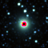
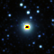

<p align="center">
  
</p>

<h1 align="center">ExoTrace</h1>

<p align="center">
  <b>Analyze the data yourself.</b><br>
  An open, browser-based lab for exploring raw NASA SPHEREx infrared data and hunting for things that move.
</p>

<p align="center">
  
  
  
</p>

<p align="center">
  
  
  
  
  
  
  
</p>

<p align="center">
  <a href="#-the-problem">Problem</a> ·
  <a href="#-our-solution">Solution</a> ·
  <a href="#-the-toolkit">Toolkit</a> ·
  <a href="#-how-it-works">How it works</a> ·
  <a href="#-quick-start">Quick start</a> ·
  <a href="#-team">Team</a>
</p>

---

## 🔭 The problem

NASA's **SPHEREx** telescope maps the entire sky in **102 infrared colours**, again and again. That repeated coverage makes it one of the best public datasets for finding faint, cold, slow-moving objects, which is exactly what a search for a distant **Planet X** needs.

The data is public. Using it is another story:

| Barrier | What it means in practice |
|---|---|
| **Raw data is hard to reach** | You need TAP queries, cutout services and FITS tooling before you see a single pixel. |
| **Every image is a different colour** | SPHEREx's detector changes wavelength across the frame, so two exposures of the same spot are not directly comparable. |
| **Movers hide in the noise** | Telling a real moving source from an artefact takes blinking, differencing and a cross-check against a reference catalogue. |

The people most motivated to look, amateur and semi-professional astronomers, are locked out.

## 💡 Our solution

**ExoTrace turns that pipeline into one click.** Pick a point on the sky, and the backend finds every SPHEREx exposure of it, downloads the Level 2 cutouts, calibrates, aligns and measures them, then hands your browser a ready-to-analyze dataset with six tools on top.

No install. No FITS. No coding. Just the real data and the tools to question it.

---

## 🧰 The toolkit

<p align="center">
  
</p>

| Tool | What it does |
|---|---|
| 🗺️ **All-sky Map** | Navigate the sky with Aladin Lite, with SPHEREx footprints and Gaia sources as overlays. |
| ⚡ **Blink** | Flip through exposures of one detector and one wavelength window. The classic way to spot a mover. |
| ➖ **Difference** | Subtract two images. *Temporal* mode shows movers and variables, *spectral* mode shows colour excess. |
| 🌈 **False-colour RGB** | Map three infrared bands to red, green and blue, so infrared colour becomes readable. |
| 📈 **SED & Lambda-time** | A wavelength-vs-time plane of flux. Brush a slice to get a spectrum or a light curve, and export it as CSV. |
| ✅ **Gaia Check** | Fits the source's motion from SPHEREx epochs, compares it with Gaia DR3 proper motion, and gives a verdict. |

### 🌟 Real output: Barnard's Star

Not mockups. These are false-colour composites our pipeline built from real SPHEREx Level 2 cutouts of **Barnard's Star**, the fastest-moving star in the sky and our benchmark for motion detection.

<p align="center">
  
  &nbsp;&nbsp;
  
</p>

---

## ⚙️ How it works


1. **Discover.** Query IRSA for every SPHEREx exposure covering your coordinate, and pull reference sources from Gaia DR3.
2. **Fetch + process.** Download Level 2 cutouts, calibrate, run photometry, reproject onto a common grid and measure centroids.
3. **Aggregate.** Group frames into epochs, build coadds and RGB composites, and assemble the spectrum (SED).
4. **Gaia check.** Fit the proper motion, compare it with Gaia, and assign a verdict.
5. **Export.** Write compact binaries, JSON and previews, validate them against a JSON Schema contract, and publish atomically.

### 🛠️ Tech stack

| Layer | Technology |
|---|---|
| **Frontend** | React 18, TypeScript, Vite, Tailwind CSS, Zustand, D3, HTML5 Canvas |
| **Sky map** | Aladin Lite 3.8 |
| **Backend** | Python 3.11+, FastAPI, Uvicorn, Pydantic v2, Typer |
| **Astronomy** | Astropy, Astroquery, PyVO, Photutils, Reproject, NumPy, SciPy |
| **Data sources** | SPHEREx Level 2 via NASA/IPAC IRSA, ESA Gaia DR3 |

---

## 🚀 Quick start

**Prerequisites:** Node.js, and Python 3.11+ with [uv](https://docs.astral.sh/uv/).

```bash
git clone https://github.com/Toghrul0303/NASA.git
cd NASA
```

**Frontend**

```bash
npm install
cp .env.example .env      # Windows: copy .env.example .env
npm run dev
```

Open the URL Vite prints (by default `http://localhost:5173`).

**Backend** (run from the repository root)

```bash
cd backend && uv sync && cd ..

backend/.venv/bin/spherex serve              # macOS / Linux
backend\.venv\Scripts\spherex.exe serve      # Windows
```

Check that it's alive:

```bash
curl http://localhost:8000/api/health
# {"status":"ok","version":"1.0.0"}
```

---

## 🗺️ Roadmap

- [x] End-to-end pipeline from sky coordinate to analysis-ready dataset
- [x] Six analysis tools in the browser
- [x] On-demand analysis of any sky position
- [ ] **Community layer:** share findings, coordinates and annotated views, and discuss them with other observers
- [ ] Collaborative vetting of candidates
- [ ] Guided tutorials for first-time users

---

## 👥 Team

| | | | | |
|:---:|:---:|:---:|:---:|:---:|
| **Kamran Makhsudov** | **Toghrul Mammedli** | **Muhammad Teymurlu** | **Tariel Shiraliyev** | **Rasul Annaghi** |

---

## 🙏 Acknowledgements

- **NASA / JPL-Caltech** for the SPHEREx mission and its open data policy
- **NASA/IPAC Infrared Science Archive (IRSA)** for hosting SPHEREx data
- **ESA Gaia** and the DPAC consortium for Gaia DR3
- **CDS, Strasbourg** for Aladin Lite and the HiPS sky surveys
- **NASA Space Apps Challenge** and the **Baku** local organizers

<p align="center">
  <sub>Built at NASA Space Apps Challenge 2026, Baku 🇦🇿 · ExoTrace is a hackathon project, not affiliated with or endorsed by NASA.</sub>
</p>
