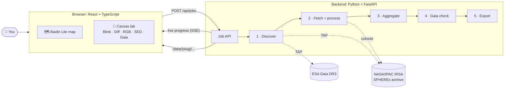

<!-- ============================================================
     ExoTrace README
     Everything marked TODO is a spot for you to fill in.
     Search this file for "TODO" to find all of them.
     ============================================================ -->

<p align="center">
  
</p>

<h1 align="center">ExoTrace</h1>

<p align="center">
  <b>Analyze the data yourself.</b><br>
  An open, browser-based lab for exploring raw NASA SPHEREx infrared data and hunting for things that move.
</p>

<p align="center">
  
  
  
</p>

<p align="center">
  
  
  
  
  
  
  
  
</p>

<p align="center">
  <a href="#-demo">Demo</a> ·
  <a href="#-the-problem">Problem</a> ·
  <a href="#-our-solution">Solution</a> ·
  <a href="#-the-toolkit">Toolkit</a> ·
  <a href="#-how-it-works">How it works</a> ·
  <a href="#-quick-start">Quick start</a> ·
  <a href="#-team">Team</a>
</p>

---

## 🎬 Demo

<!-- TODO: record a 10-15 second GIF of the app (map -> pick a target -> blink -> Gaia check)
     and save it as docs/assets/demo.gif. Keep it under 10 MB. -->

<p align="center">
  
</p>

<p align="center">
  <!-- TODO: replace both links -->
  <a href="TODO_LIVE_DEMO_URL"><b>🚀 Live demo</b></a> ·
  <a href="TODO_PITCH_VIDEO_OR_SLIDES_URL"><b>📽️ Pitch deck</b></a>
</p>

---

## 🔭 The problem

NASA's **SPHEREx** telescope maps the entire sky in **102 infrared colours**, again and again. That repeated coverage makes it one of the best public datasets for finding faint, cold, slow-moving objects, which is exactly what a search for a distant **Planet X** needs.

The data is public. Using it is another story:

| Barrier | What it means in practice |
|---|---|
| **Raw data is hard to reach** | You need TAP queries, cutout services and FITS tooling before you see a single pixel. |
| **Every image is a different colour** | SPHEREx's detector changes wavelength across the frame, so two exposures of the same spot are not directly comparable. |
| **Movers hide in the noise** | Telling a real moving source from an artefact takes blinking, differencing and a cross-check against a reference catalogue. |

The result: the people most motivated to look (amateur and semi-professional astronomers) are locked out.

## 💡 Our solution

**ExoTrace turns that pipeline into one click.** Pick a point on the sky, and the backend finds every SPHEREx exposure of it, downloads the Level 2 cutouts, calibrates, aligns and measures them, then hands your browser a ready-to-analyze dataset with six tools on top.

No install. No FITS. No coding. Just the real data and the tools to question it.

> **What makes it different:** ExoTrace doesn't show you a pretty picture and tell you what to think. It gives you the actual measurements, the uncertainties, and an honest verdict, and lets you check the work.

---

## 🧰 The toolkit

<p align="center">
  
</p>

| Tool | What it does | Why it matters |
|---|---|---|
| 🗺️ **All-sky Map** | Navigate the sky with Aladin Lite, see SPHEREx footprints and Gaia sources as overlays. | You always know where you are and what is already catalogued there. |
| ⚡ **Blink** | Flip through exposures of one detector and one wavelength window, with keyboard control and adjustable speed. | The classic way to spot a mover. It's how Pluto was found. |
| ➖ **Difference** | Subtract two images. *Temporal* mode shows movers and variables, *spectral* mode shows colour excess. | Everything static cancels out, so what's left deserves a look. |
| 🌈 **False-colour RGB** | Map three infrared bands to red, green and blue. | Makes infrared colour, invisible to the eye, readable at a glance. |
| 📈 **SED & Lambda-time** | A wavelength-vs-time plane of flux. Brush a slice to get a spectrum or a light curve. Export as CSV. | One view answers both "what is it made of?" and "did it change?". |
| ✅ **Gaia Check** | Fits the source's motion from SPHEREx epochs and compares it against Gaia DR3 proper motion, then gives a verdict. | An independent sanity check: known star, or something that isn't in the catalogue? |

### 📸 Screenshots

<!-- TODO: add real screenshots of the app to docs/assets/ with these names -->

<table>
  <tr>
    <td width="50%"><br><p align="center"><sub>All-sky map with footprint and Gaia overlay</sub></p></td>
    <td width="50%"><br><p align="center"><sub>Blinking epochs in the lab</sub></p></td>
  </tr>
  <tr>
    <td width="50%"><br><p align="center"><sub>SED and lambda-time view</sub></p></td>
    <td width="50%"><br><p align="center"><sub>Gaia check with verdict</sub></p></td>
  </tr>
</table>

### 🌟 Real output: Barnard's Star

These are not mockups. They are false-colour composites our pipeline built from real SPHEREx Level 2 cutouts of **Barnard's Star**, the fastest-moving star in the sky and our benchmark for motion detection.

<p align="center">
  
  &nbsp;&nbsp;
  
</p>

---

## ⚙️ How it works



**The pipeline, step by step:**

1. **Discover.** Query IRSA for every SPHEREx exposure covering your coordinate, remove duplicates, and pull reference sources from Gaia DR3.
2. **Fetch + process.** Download Level 2 cutouts in parallel, calibrate them, run photometry, reproject onto a common grid and measure centroids.
3. **Aggregate.** Group frames into epochs, build coadds and RGB composites, and assemble the spectrum (SED).
4. **Gaia check.** Fit the measured proper motion, compare it with Gaia, and assign a verdict.
5. **Export.** Write compact binaries, JSON and previews, validate them against a JSON Schema contract, and publish atomically.

**Engineering choices worth a look:**

- **Contract-first.** Frontend and backend share one versioned data contract (`docs/DATA_CONTRACT.md`) enforced by JSON Schema on export and re-validated in the browser.
- **Compact by design.** Image stacks ship as float16 binaries with intensity *and* uncertainty planes, so the browser gets real error bars, not just pictures.
- **Deterministic caching.** Each request hashes to a stable slug. Ask for the same position twice and the answer is instant.
- **Live progress.** Jobs stream their status over Server-Sent Events with replay, so a refresh never loses your place.
- **Respectful of NASA services.** The browser never calls IRSA or ESA directly. The backend caps concurrency, retries politely and caches results.
- **Shareable state.** The view is synced to the URL, so a discovery is a link you can send.

---

## 🛠️ Tech stack

| Layer | Technology |
|---|---|
| **Frontend** | React 18, TypeScript, Vite, Tailwind CSS, Zustand, D3 (scales and formatting), HTML5 Canvas |
| **Sky map** | Aladin Lite 3.8 (CDS, Strasbourg) |
| **Backend** | Python 3.11+, FastAPI, Uvicorn, Pydantic v2, Typer (CLI) |
| **Astronomy** | Astropy, Astroquery, PyVO, Photutils, Reproject, NumPy, SciPy |
| **Data sources** | SPHEREx Level 2 via NASA/IPAC IRSA (TAP + cutout service), ESA Gaia DR3 |
| **Quality** | Vitest, Pytest, ESLint (incl. accessibility rules), Prettier, JSON Schema validation |

---

## 🚀 Quick start

### Prerequisites

- **Node.js** 20 or newer
- **Python** 3.11 or newer and [**uv**](https://docs.astral.sh/uv/)

### 1. Clone

```bash
git clone https://github.com/Toghrul0303/NASA.git
cd NASA
```

### 2. Frontend

```bash
npm install
cp .env.example .env      # Windows: copy .env.example .env
npm run dev
```

Open the URL Vite prints (by default `http://localhost:5173`).

> **No backend? No problem.** Set `VITE_USE_MOCKS=1` in `.env` and the app runs on the bundled Barnard's Star dataset.

### 3. Backend

Run these from the **repository root** (the default config path resolves from there).

```bash
# install
cd backend && uv sync && cd ..

# start the API on port 8000
backend/.venv/bin/spherex serve              # macOS / Linux
backend\.venv\Scripts\spherex.exe serve      # Windows
```

Check that it's alive:

```bash
curl http://localhost:8000/api/health
# {"status":"ok","version":"1.0.0"}
```

### 4. Try a real analysis

This request targets **WISE 0855**, one of the coldest known brown dwarfs and a great stand-in for a faint, fast-moving object:

```bash
curl -X POST http://localhost:8000/api/jobs \
  -H "Content-Type: application/json" \
  -d '{"ra_deg":133.795129,"dec_deg":-7.245147,"size_deg":0.1,"name":"WISE 0855 coord","pmra_mas_yr":-8120,"pmdec_mas_yr":679}'
```

### Useful commands

| Command | What it does |
|---|---|
| `npm run dev` | Start the frontend dev server |
| `npm run build` | Type-check and build for production |
| `npm test` | Run the frontend unit tests |
| `npm run lint` | Lint the frontend |
| `spherex serve` | Start the backend API |
| `spherex validate --all` | Validate the built-in targets against the data contract |

More detail: [`docs/RUNBOOK.md`](docs/RUNBOOK.md)

---

## 🎯 Built-in targets

We ship a curated set of targets chosen to stress-test motion and variability detection:

| Target | Why it's here |
|---|---|
| **Barnard's Star** | Highest proper motion of any star. If we can't see this move, we can't see anything move. |
| **WISE 0855** | Extremely cold, red and faint brown dwarf with no Gaia counterpart. The closest known analogue to what a distant planet would look like. |
| **Eps Indi B** | A close brown-dwarf pair, a test for blended sources. |
| **RW Aur** | A young variable star, a test for the time axis. |
| **R Dra** | A bright long-period variable, a test for spectral change. |

Any other position on the sky can be analyzed on demand from the map.

---

## 📁 Project structure

```
NASA/
├── src/                  # Frontend (React + TypeScript)
│   ├── map/              #   Aladin Lite map, footprints, Gaia overlay
│   ├── lab/              #   Canvas lab and the analysis tools
│   ├── core/             #   Pure maths: stretch, difference, RGB, SED, WCS
│   ├── jobs/             #   "Analyze this position" flow and live progress
│   ├── contract/         #   Data contract types and runtime validation
│   └── state/            #   Zustand store and URL sync
├── backend/              # Backend (Python + FastAPI)
│   ├── src/spherex_backend/   # Pipeline, API, CLI
│   └── schemas/v1/            # JSON Schemas for the data contract
├── docs/                 # Specs, data contract, runbook
├── public/data/          # Bundled demo dataset
├── scripts/              # Fixture and pre-warm scripts
└── tests/unit/           # Frontend unit tests
```

---

## 🔬 Scientific honesty

We would rather be trusted than impressive.

- ExoTrace produces **quick-look results from Level 2 cutouts**. It is **not science-grade photometry**, and the app says so on every photometry view.
- A difference image shows **where two images differ**. By itself it does not prove a source is real or that anything moved.
- Every flux comes with its **uncertainty**, and bad pixels are masked using the official SPHEREx quality flags.
- A candidate found here is a **reason to look closer**, not a discovery claim.

---

## 🗺️ Roadmap

- [x] End-to-end pipeline from sky coordinate to analysis-ready dataset
- [x] Six analysis tools in the browser
- [x] On-demand analysis of any sky position
- [ ] **Community layer:** share findings, coordinates and annotated views, and discuss them with other observers
- [ ] Candidate lists and collaborative vetting
- [ ] Guided tutorials for first-time users
- [ ] Batch search over sky regions

---

## 👥 Team

<!-- TODO: for each member, replace GITHUB_USERNAME (the avatar loads automatically from GitHub)
     or point src to your own photo, e.g. docs/assets/team/kamran.jpg. Then fill in the role. -->

<table>
  <tr>
    <td align="center" width="20%">
      <br>
      <b>Kamran Makhsudov</b><br>
      <sub>TODO: role</sub>
    </td>
    <td align="center" width="20%">
      <br>
      <b>Toghrul Mammedli</b><br>
      <sub>TODO: role</sub>
    </td>
    <td align="center" width="20%">
      <br>
      <b>Muhammad Teymurlu</b><br>
      <sub>TODO: role</sub>
    </td>
    <td align="center" width="20%">
      <br>
      <b>Tariel Shiraliyev</b><br>
      <sub>TODO: role</sub>
    </td>
    <td align="center" width="20%">
      <br>
      <b>Rasul Annaghi</b><br>
      <sub>TODO: role</sub>
    </td>
  </tr>
</table>

<p align="center">
  <!-- TODO: optional team photo from the hackathon -->
  
</p>

---

## 🙏 Acknowledgements

- **NASA / JPL-Caltech** for the SPHEREx mission and its open data policy
- **NASA/IPAC Infrared Science Archive (IRSA)** for hosting and serving SPHEREx data
- **ESA Gaia** and the DPAC consortium for Gaia DR3
- **CDS, Strasbourg** for Aladin Lite and the HiPS sky surveys
- **NASA Space Apps Challenge** and the **Baku** local organizers

*ExoTrace is a hackathon project. It is not affiliated with or endorsed by NASA.*

## 📄 License

<!-- TODO: pick a license (MIT is the usual choice for hackathon projects) and add a LICENSE file -->
TODO

---

<p align="center">
  Built in 48 hours at <b>NASA Space Apps Challenge 2026, Baku</b> 🇦🇿<br>
  <sub>Made with curiosity by Team ExoTrace</sub>
</p>
